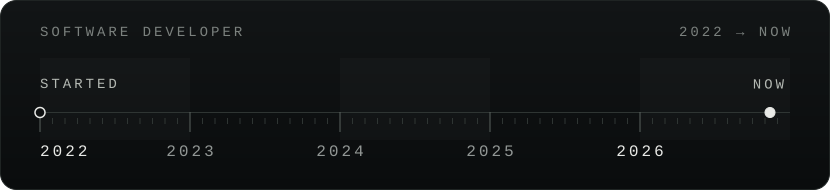
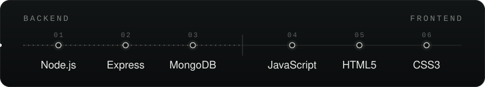

 

<table width="100%">
<tr>
<td width="38%" valign="top">
<code>PROFESSIONALLY SINCE 2022</code> 
<b>Software Developer.</b>
</td>
<td width="62%" valign="top">
Backend developer shipping production software since 2022. 
Coder by passion, rider by soul.  
Open to open-source collaboration and challenging projects.
</td>
</tr>
</table>

<table width="100%">
<tr>
<td width="38%" valign="top"><code>BASED IN</code></td>
<td width="62%" valign="top">Meerut, Uttar Pradesh, India</td>
</tr>
<tr>
<td valign="top"><code>WRITE TO</code></td>
<td valign="top"><a href="mailto:harshpratap1444@gmail.com">harshpratap1444@gmail.com</a></td>
</tr>
<tr>
<td valign="top"><code>OFF SCREEN</code></td>
<td valign="top">Music, cricket</td>
</tr>
</table>

  

  

  <a href="https://skyline.github.com/harsh-developer/2026">View my 2026 contribution skyline →</a>

  
  <a href="https://github.com/harsh-developer">GitHub</a> &nbsp;/&nbsp;
  <a href="https://www.linkedin.com/in/harsh-pratap-singh-606816224/">LinkedIn</a> &nbsp;/&nbsp;
  <a href="https://twitter.com/h_harssh_me">Twitter</a> &nbsp;/&nbsp;
  <a href="https://www.instagram.com/h_harssh_me/">Instagram</a> &nbsp;/&nbsp;
  <a href="https://www.facebook.com/profile.php?id=100022262282917">Facebook</a> &nbsp;/&nbsp;
  <a href="https://discord.com/users/h_harssh#8231">Discord</a>
  

